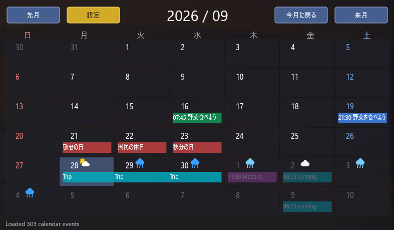

# Google Calendar Month for Rainmeter

Googleカレンダーの予定を、Windowsデスクトップに月間表示するRainmeterスキンです。  
A monthly Google Calendar skin for Rainmeter using iCal / ICS.

  

> 画像をクリックすると原寸で表示できます。

## ダウンロード

**最新バージョン：v1.1.7**

- [最新版をダウンロード](https://github.com/kuroken2002/GoogleCalendarMonth-Rainmeter/releases/latest)
- [すべてのリリース](https://github.com/kuroken2002/GoogleCalendarMonth-Rainmeter/releases)
- [Rainmeter公式サイト](https://www.rainmeter.net/)

## 目次

- [主な機能](#主な機能)
- [必要環境](#必要環境)
- [インストール](#インストール)
- [初期設定](#初期設定)
- [天気表示](#天気表示)
- [iCal URLとプライバシー](#ical-urlとプライバシー)
- [対応言語](#対応言語)
- [更新履歴](#更新履歴)
- [フィードバック](#フィードバック)
- [English](#english)

---

## 主な機能

### カレンダー

- Google Calendarの非公開iCal / ICS URLに対応
- 月間カレンダー表示
- 前月・今月・来月へ移動
- 週の開始曜日を日曜始まり・月曜始まりから選択
- 日曜日・土曜日を色分け
- 1日に表示する予定数を1～5件から選択
- 予定数に合わせてカレンダーの高さを自動調整
- 予定ごとの背景色表示
- 複数日にまたがる予定を連続した帯で表示
- BYDAYを含む月次繰り返し予定に対応
- iCal更新間隔を1～60分で設定

### 共有カレンダー・祝日

- メインと共有、2つのiCal URLを登録可能
- メイン・共有カレンダーを個別にON / OFF
- 共有カレンダーURLが空の場合は自動的に無視
- 祝日表示は初期状態でON
- 表示言語に合わせて祝日の国を自動選択

| 表示言語 | 祝日 |
|---|---|
| 日本語 | 日本 |
| English | United States |
| Français | France |
| Deutsch | Germany |

### 音声読み上げ

- 起動時に予定を読み上げ
- 今日・明日の予定に対応
- 定時読み上げを2枠設定
- 読み上げ前に現在時刻を案内
- 予定がない場合の読み上げに対応
- 判定間隔を設定可能
- テスト読み上げボタン
- メイン・共有カレンダーを読み上げ対象として個別にON / OFF

### 設定画面

設定画面は、次の4タブで構成されています。

| タブ | 設定内容 |
|---|---|
| iCal | メイン・共有カレンダー、祝日、天気、緯度・経度 |
| 基本設定 | 更新間隔、表示件数、表示言語、週の開始曜日 |
| 配色 | カレンダーと予定の表示色 |
| 読み上げ | 読み上げ対象、起動時・定時読み上げ、予定がない場合の動作 |

iCal URLは、入力確定後に設定画面上でマスク表示されます。

### 天気・更新通知

- Open-Meteoによる7日分の天気表示
- 天気表示は初期状態でOFF
- 緯度・経度を手動入力
- 通信失敗時は取得済みの予報を最大6時間保持
- GitHubの最新リリースを定期確認
- 新しいバージョンがある場合のみ通知
- 通知をクリックするとGitHub Releasesを表示
- 自動更新は行いません

---

## 必要環境

- Windows 10 / 11
- Rainmeter 4.5.26以降
- インターネット接続
- Windows SAPI（音声読み上げを使用する場合）

## インストール

### `.rmskin`を使用する場合

1. [GitHub Releases](https://github.com/kuroken2002/GoogleCalendarMonth-Rainmeter/releases/latest)から`Google.Calendar.Month_1.1.7.rmskin`をダウンロードします。
2. ダウンロードしたファイルを実行します。
3. Rainmeter Skin Installerの案内に従ってインストールします。

### 新規・手動インストール

1. `GoogleCalendarMonth_1.1.7.zip`を展開します。
2. ZIP内の`GoogleCalendarMonth`フォルダーを`ドキュメント\Rainmeter\Skins`へコピーします。
3. Rainmeterの管理画面で「すべて更新」を実行します。
4. `GoogleCalendarMonth\GoogleCalendarMonth.ini`を読み込みます。

### 既存設定を維持して更新

1. 念のため、既存の`GoogleCalendarMonth`フォルダーをバックアップします。
2. `GoogleCalendarMonth_1.1.7_upgrade.zip`を展開します。
3. 既存の`GoogleCalendarMonth`フォルダーを削除せず、そのまま上書きします。
4. Rainmeterで「すべて更新」を実行します。

## 初期設定

1. Google Calendarの設定から「非公開iCal」のURLを取得します。
2. RainmeterでGoogle Calendar Monthの設定画面を開きます。
3. 「iCal」タブにメインカレンダーのiCal URLを入力します。
4. 共有カレンダーを使う場合は、同じタブに共有カレンダーのiCal URLを入力します。
5. URLを入力したら、Enterキーで確定します。
6. 「基本設定」タブで表示言語や週の開始曜日を選択します。
7. 「保存して閉じる」を押します。

## 天気表示

天気表示は初期状態でOFFです。

1. 「iCal」タブで天気表示をONにします。
2. 表示したい地域の緯度・経度を入力します。
3. 「保存して閉じる」を押します。

- 初期座標は東京駅付近です。
- v1.1.5にあった「現在地を取得」ボタンは含まれません。
- 今日のアイコンには現在の天気情報を使用し、以降は日別予報を表示します。
- 天気情報の取得に失敗した場合、最後に取得した予報を最大6時間使用します。

## iCal URLとプライバシー

Google Calendarの「非公開iCal」を使用します。共有カレンダーにも、RainmeterからアクセスできるiCal URLが必要です。

> [!CAUTION]
> iCal URLには個人情報が含まれる場合があります。設定画面上ではマスクされますが、`@Resources/Variables.inc`には平文で保存されます。リポジトリ、フォーラム投稿、スクリーンショットなどに掲載しないでください。

取得したカレンダーデータはローカルで処理されます。

## 対応言語

- 日本語
- English
- Français
- Deutsch

---

## 更新履歴

### v1.1.7

- 週の開始曜日を日曜始まり・月曜始まりから選択可能
- 月曜始まりでも日曜日・土曜日の文字色を正しく表示
- 初回起動時の表示言語を日本語に設定
- 設定ファイルがない場合の既定値処理を追加
- `Variables.inc`がない場合でもiCal URLと各種設定を新規保存可能
- メイン・共有iCal、天気、配色、読み上げ、週開始曜日の保存処理を改善

<strong>過去の更新履歴を表示</strong>

### v1.1.6

- 設定画面を「iCal / 基本設定 / 配色 / 読み上げ」の4タブに整理
- メイン・共有iCal URLを入力後に画面上でマスク表示
- 今日の天気は現在の情報、以降は日別予報を表示
- 天気取得に失敗した場合は予報を最大6時間保持
- 設定画面の重なりと設定保存後の天気表示を修正
- テスト用の診断ログ書き出しを削除

### v1.1.5

- 7日分の天気アイコン表示に対応（初期状態はOFF）
- 「現在地を取得」ボタンと初回設定案内を追加
- 緯度・経度の手動入力に対応
- 天気取得失敗時の再試行・代替取得に対応
- 天気キャッシュを利用した表示に対応

### v1.1.4

- メインiCal設定を「基本設定」タブへ統合
- 1日に表示できる予定数を最大5件へ拡張
- メイン・共有カレンダーの両方を読み上げ可能に変更
- 読み上げ対象を個別にON / OFF可能
- 設定画面のレイアウトを整理

### v1.1.3

- 共有カレンダー1件に対応
- 日本・アメリカ・フランス・ドイツの祝日表示
- 表示言語に応じた祝日の自動選択
- 更新通知機能を追加
- iCal URL入力欄と設定画面のレイアウトを改善

### v1.1.2

- 多言語表示に対応
- 1日の予定表示数を1～3件から選択可能
- 設定画面をタブ形式に変更
- 低解像度PC向けに設定画面を改善
- 空のiCal URL設定時に古いキャッシュを削除

## フィードバック

「動いたよ」のひとことだけでも歓迎です。感想、設定で困ったこと、不具合、ご要望をお寄せください。

- [感想・使用報告（GitHub Discussions）](https://github.com/kuroken2002/GoogleCalendarMonth-Rainmeter/discussions/2)
- [Rainmeter Forum](https://forum.rainmeter.net/viewtopic.php?t=46019)

## 改良・派生について

このプロジェクトの解析、改良、派生開発を歓迎します。バグ修正、改善、新機能を作成した場合は、GitHub Issue、Pull Request、またはRainmeter Forumを通じてお知らせください。多くの利用者に役立つ改善であれば、本家への取り込みも検討します。

---

## English

<strong>Show English documentation</strong>

### Overview

Google Calendar Month is a Rainmeter skin that displays Google Calendar events in a monthly calendar view using private iCal / ICS URLs.

### Features

- Monthly calendar with previous, current, and next month navigation
- Main and shared Google Calendar support
- Sunday-first or Monday-first week layout
- One to five events per day with automatic height adjustment
- Sunday and Saturday color highlighting
- Event background colors and continuous multi-day event bands
- Monthly recurring events, including BYDAY rules
- Holiday calendars for Japan, the United States, France, and Germany
- Japanese, English, French, and German interfaces
- Startup and two scheduled voice announcements
- Independent voice targets for main and shared calendars
- Optional seven-day weather icons using Open-Meteo
- New-release notifications without automatic installation

### Requirements

- Windows 10 / 11
- Rainmeter 4.5.26 or later
- Internet connection
- Windows SAPI for voice announcements

### Installation

#### Rainmeter package

1. Download `Google.Calendar.Month_1.1.7.rmskin` from [GitHub Releases](https://github.com/kuroken2002/GoogleCalendarMonth-Rainmeter/releases/latest).
2. Run the downloaded package.
3. Follow the Rainmeter Skin Installer instructions.

#### New manual installation

1. Extract `GoogleCalendarMonth_1.1.7.zip`.
2. Copy the `GoogleCalendarMonth` folder to `Documents\Rainmeter\Skins`.
3. Select **Refresh all** in Rainmeter Manage.
4. Load `GoogleCalendarMonth\GoogleCalendarMonth.ini`.

#### Update while preserving settings

1. Back up the existing `GoogleCalendarMonth` folder.
2. Extract `GoogleCalendarMonth_1.1.7_upgrade.zip`.
3. Copy it over the existing folder without deleting that folder first.
4. Select **Refresh all** in Rainmeter Manage.

### Setup

1. Get the **Secret address in iCal format** from Google Calendar.
2. Open the skin settings.
3. Enter the main calendar URL in the **iCal** tab.
4. Enter a shared calendar URL in the same tab if needed.
5. Press Enter after entering each URL.
6. Select the language and week start in **Basic Settings**.
7. Click **Save and Close**.

### Weather

Weather is OFF by default. Enable it in the iCal tab and enter latitude and longitude manually. The default coordinates are near Tokyo Station. Today's icon uses the current condition, while later days use the daily forecast. The last forecast remains available for up to six hours after a failed refresh.

### Privacy

> [!CAUTION]
> iCal URLs may contain private information. They are masked on screen but stored as plain text in `@Resources/Variables.inc`. Do not publish them in repositories, forum posts, or screenshots.

Calendar data is processed locally.

### Changes in v1.1.7

- Added Sunday-first and Monday-first week selection
- Corrected Sunday and Saturday colors in Monday-first mode
- Set Japanese as the initial display language
- Added safe defaults when settings files are missing
- Added automatic settings-file creation
- Improved saving for calendars, weather, colors, speech, and week-start settings

### Feedback

Even a quick “It works!” is welcome. Please share feedback, setup questions, bugs, or feature requests in [GitHub Discussions](https://github.com/kuroken2002/GoogleCalendarMonth-Rainmeter/discussions/2) or the [Rainmeter Forum](https://forum.rainmeter.net/viewtopic.php?t=46019).

## Author

[kuroken2002](https://github.com/kuroken2002)
